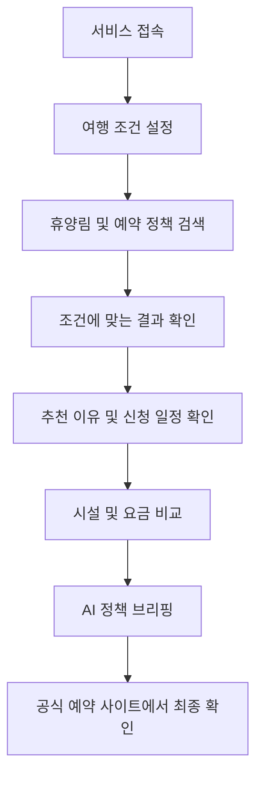
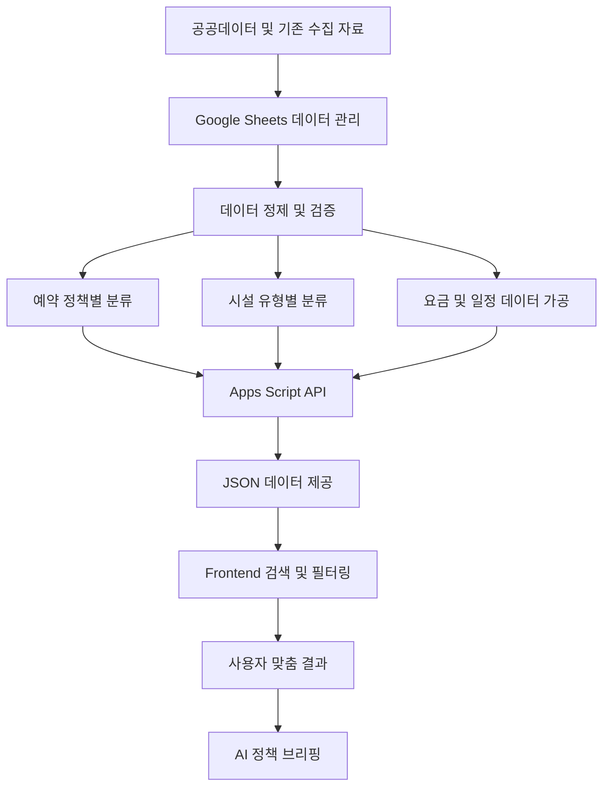
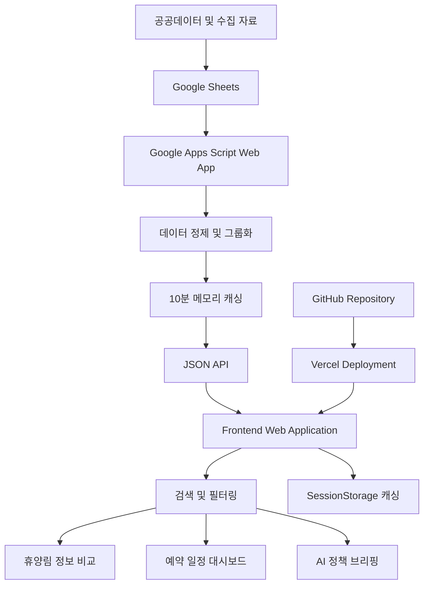

# 🌲 숲나들e AI 휴식 비서
### 몰라서 놓쳤던 숲에서의 휴식, 이제 미리 발견하세요.

> 흩어져 있는 국립자연휴양림의 예약 정보와 이용 정책을 데이터로 연결하고,  
> 사용자에게 필요한 휴양림과 예약 기회를 미리 안내하는 AI 기반 휴식 정보 서비스입니다.

  <a href="https://forest-reservation-service.vercel.app/">
    <strong>🌿 서비스 바로가기 (Live Demo)</strong>
  </a>

---

## 0. 서비스 이용하기

🌲 **Live Demo**

[https://forest-reservation-service.vercel.app/](https://forest-reservation-service.vercel.app/)

서비스에 접속하여 원하는 지역, 이용 조건 및 예약 유형을 설정하고 나에게 맞는 국립자연휴양림 정보를 탐색할 수 있습니다.

---
---

## 1. 프로젝트 소개

국립자연휴양림은 자연 속에서 휴식을 즐길 수 있는 공공시설이지만, 모든 이용자가 동일한 방식으로 예약하는 것은 아닙니다.

다자녀 가정, 장애인, 산림복지서비스 이용권 보유자 등을 위한 우선예약 제도부터 일반 예약, 추첨예약까지 다양한 예약 정책이 운영되고 있습니다.

그러나 이러한 정보는 휴양림별로 분산되어 있으며, 이용자는 자신에게 해당하는 예약 제도가 있는지, 언제 신청해야 하는지, 어떤 시설을 이용할 수 있는지 직접 확인해야 합니다.

**숲나들e AI 휴식 비서**는 이러한 정보 탐색의 불편함을 해결하기 위해 시작한 프로젝트입니다.

기존에 수집하고 정리했던 국립자연휴양림 예약 데이터를 활용하여, 단순한 정보 조회를 넘어 사용자의 조건에 맞는 휴양림과 예약 정책을 탐색하고 다가오는 신청 일정을 미리 확인할 수 있도록 서비스를 구현했습니다.

### 🎯 프로젝트 목표

- 흩어진 공공 예약 정보를 하나의 서비스에서 탐색할 수 있도록 통합
- 사용자의 조건에 맞는 예약 정책과 휴양림을 쉽게 발견
- 신청 기간을 놓치지 않도록 예약 일정 사전 안내
- 객실 유형, 수용 인원, 요금 정보를 비교하여 합리적인 선택 지원
- 공공데이터를 실제 사용자의 문제 해결에 활용하는 서비스 구현

---

## 2. 기획 배경 | 데이터에서 서비스로

본 프로젝트는 처음부터 웹서비스를 개발하는 것에서 출발하지 않았습니다.

숲나들e 예약 정보를 수집하고 정리하는 과정에서, 데이터를 확보하는 것만큼 중요한 것은 **사용자가 그 데이터를 활용할 수 있도록 전달하는 방법**이라는 문제를 발견했습니다.

### 기존 이용 방식의 불편함

| 문제 | 기존 이용자가 겪는 어려움 |
|---|---|
| 정보의 파편화 | 휴양림마다 다른 예약 정책과 이용 조건을 개별적으로 확인해야 함 |
| 예약 일정의 불확실성 | 특정 기간에만 신청 가능한 우선예약·추첨예약 일정을 놓치기 쉬움 |
| 조건 탐색의 번거로움 | 지역, 시설 유형, 이용 인원, 자격 조건을 하나씩 비교해야 함 |
| 요금 비교의 어려움 | 비수기·성수기, 평일·주말에 따라 달라지는 요금을 직접 확인해야 함 |
| 정보 이해의 어려움 | 기관별 정책과 신청 조건이 복잡하여 자신에게 해당하는 제도를 판단하기 어려움 |

### 💡 문제 해결 방향

기존의 데이터 수집 및 정리 과정을 서비스의 기반으로 활용하고, 다음과 같은 구조로 발전시켰습니다.

**데이터 수집 → 데이터 정제 → 정책 및 시설 정보 구조화 → 사용자 조건 매칭 → 신청 일정 안내 → AI 정보 브리핑**

데이터를 단순히 저장하거나 나열하는 데 그치지 않고, 사용자가 실제로 휴양림을 선택하고 예약을 준비하는 과정에 활용할 수 있도록 설계했습니다.

---

## 3. 서비스 핵심 기능

### ① 나에게 맞는 휴양림 및 예약 정책 찾기

사용자가 원하는 조건을 설정하면 해당 조건에 적합한 휴양림과 예약 정책을 탐색합니다.

**검색 조건**

- 지역 : 원하는 시·도 및 지역
- 예약 유형 : 다자녀 우선예약, 장애인 우선예약, 산림복지서비스 이용권, 일반예약 및 추첨예약 등
- 시설 유형 : 숲속의집, 연립동, 야영장 및 야영데크
- 이용 희망 월 : 원하는 여행 시기
- 최소 수용 인원 : 여행 인원에 맞는 시설 탐색
- 예산 : 숙박 및 시설 이용료 기준

단순히 검색 결과를 보여주는 것이 아니라, 사용자가 설정한 조건과 해당 휴양림의 정책이 어떤 부분에서 일치하는지 추천 이유를 함께 제공합니다.

> ※ 예약 정책에 대한 매칭 결과는 정보 탐색을 돕기 위한 안내입니다. 실제 신청 가능 여부는 해당 기관의 자격 기준과 증빙 서류 확인이 필요합니다.

### ② 예약 일정 사전 안내 대시보드

예약 신청 기간을 데이터에 기록된 일정과 현재 날짜를 기준으로 구분하여 표시합니다.

| 일정 상태 | 설명 |
|---|---|
| 🟢 공식 일정 · 현재 접수중 | 공식 데이터에 기록된 신청 기간이 현재 진행 중 |
| 🔵 공식 일정 · 신청 예정 | 공식적으로 확인된 신청 기간이 아직 시작되지 않음 |
| 🟡 전년도 일정 기반 예상 | 과거 일정에 기반한 참고 정보이며 올해 일정은 확정되지 않음 |

공식적으로 확인된 일정과 과거 데이터를 바탕으로 추정한 일정을 명확히 분리하여, 사용자가 예상 일정을 확정된 정보로 오해하지 않도록 설계했습니다.

### ③ 휴양림 시설 및 요금 비교

검색 결과에 포함된 휴양림의 시설 정보를 비교할 수 있도록 구성했습니다.

- 휴양림 및 시설명
- 시설 유형
- 객실 및 시설 수용 인원
- 비수기 평일 요금
- 비수기 주말 요금
- 성수기 평일 요금
- 성수기 주말 요금
- 예약 정책 및 운영 방식

사용자가 여러 휴양림의 정보를 개별적으로 확인하지 않아도, 원하는 조건에 적합한 시설을 비교하고 선택할 수 있도록 지원합니다.

### ④ AI 정책 설명 브리핑

복잡한 예약 정책과 시설 정보를 이해하기 쉬운 형태로 요약합니다.

선택한 휴양림의 정보를 기반으로 다음 내용을 단계별로 안내합니다.

1. **정책 이해** — 어떤 예약 제도인지
2. **신청 일정** — 언제 신청하고 언제 이용할 수 있는지
3. **이용 정보** — 시설 유형, 수용 인원, 요금 등
4. **신청 전 확인사항** — 자격 조건, 증빙 서류 및 주의사항

AI는 확보된 데이터에 기반하여 정보를 설명하는 역할을 수행하며, 공식 기관의 자격 판정이나 예약 확정을 대신하지 않습니다.

---

## 4. 사용자 이용 흐름

사용자는 복잡한 예약 정보를 직접 탐색하는 대신, 자신의 여행 조건을 입력하고 적합한 정보를 확인하는 방식으로 서비스를 이용할 수 있습니다.

---

## 5. 데이터 활용 및 가공 과정

본 프로젝트의 핵심은 기존에 수집했던 공공데이터를 실제 서비스에 활용할 수 있는 형태로 재구성한 것입니다.

### 데이터 파이프라인

### 데이터 처리 방식

**1. 데이터 수집 및 관리**

국립자연휴양림 관련 예약 정책, 시설 정보, 신청 일정 및 요금 데이터를 수집하고 Google Sheets를 데이터 관리 기반으로 활용합니다.

**2. 데이터 정제**

서비스에서 활용할 수 있도록 데이터 형식과 항목을 정리하고, 검색 및 비교에 필요한 기준을 통일합니다.

**3. 데이터 구조화**

휴양림, 예약 정책, 시설 유형 및 요금 정보를 서비스에서 활용하기 적합한 형태로 분류합니다.

**4. 데이터 가공 및 API 제공**

Google Apps Script를 활용하여 원본 데이터를 정제하고, 기관·정책·시설 유형별로 그룹화한 JSON 데이터를 제공합니다.

**5. 사용자 조건 기반 검색**

Frontend에서 제공받은 데이터를 활용하여 지역, 이용 시기, 예약 유형, 시설 조건 및 예산 등을 기준으로 검색하고 필터링합니다.

**6. AI 활용**

구조화된 데이터를 기반으로 사용자가 이해하기 어려운 정책 정보를 요약하고, 주요 신청 일정과 확인사항을 안내합니다.

---

## 6. 시스템 아키텍처

별도의 상시 운영 서버 없이 데이터 관리, API 제공 및 웹서비스 배포를 연결하는 Serverless 기반 구조로 구현했습니다.

### 기술 스택

| 구분 | 기술 | 활용 목적 |
|---|---|---|
| Frontend | HTML5 | 웹 페이지 구조 |
| Styling | Tailwind CSS | 반응형 UI 및 디자인 |
| Frontend Logic | Vanilla JavaScript | 검색, 필터링, 데이터 처리 및 사용자 인터랙션 |
| Data Management | Google Sheets | 공공데이터 및 서비스 데이터 관리 |
| Backend API | Google Apps Script | 데이터 가공 및 API 제공 |
| Data Format | JSON | Frontend와 API 간 데이터 통신 |
| Cache | Apps Script Cache / SessionStorage | 반복 요청 감소 및 응답 속도 개선 |
| Version Control | Git / GitHub | 소스코드 관리 및 변경 이력 |
| Deployment | Vercel | 웹서비스 배포 및 운영 |

---

## 7. 기술적 고민 및 구현 포인트

### ⚡ 서버 비용과 응답 속도

별도의 상시 운영 서버 없이 Google Apps Script와 Vercel을 활용하여 서비스 구조를 구성했습니다.

- Apps Script에서 데이터를 정제하고 그룹화하여 전달
- 반복적인 데이터 요청을 줄이기 위해 10분 캐싱 적용
- 브라우저 SessionStorage를 활용한 2차 캐싱
- Frontend에서 필요한 데이터를 효율적으로 처리

이를 통해 데이터 관리의 편의성과 서비스 응답 속도를 고려한 경량 구조를 구현했습니다.

### 🛡️ 데이터 신뢰성

예약 정보는 사용자의 실제 여행 계획과 연결되기 때문에 데이터의 정확성과 정보의 출처 구분이 중요합니다.

- 공식적으로 확인된 일정과 예상 일정을 구분
- 과거 데이터 기반 예상 정보에 확정 표현을 사용하지 않음
- 자격 조건을 임의로 판정하지 않음
- 실제 신청 가능 여부는 공식 기관 확인이 필요함을 안내
- AI 설명은 확보된 데이터 범위 내에서 제공하도록 설계

### 🔍 사용자 중심 데이터 가공

데이터를 수집하는 관점이 아닌, 사용자가 어떤 정보를 필요로 하는지에 맞춰 데이터를 재구성했습니다.

예를 들어 단순히 예약 시작일을 제공하는 대신, 해당 일정이 현재 접수 중인지, 앞으로 신청할 수 있는 일정인지, 과거 일정에 기반한 예상인지 구분하여 제공합니다.

---

## 8. 프로젝트 개발 과정

| 단계 | 주요 작업 |
|---|---|
| 01. 문제 발견 | 숲나들e 예약 정보 탐색 과정에서 발생하는 정보 분산 및 신청 일정 확인의 불편함 발견 |
| 02. 데이터 확보 | 공공데이터 및 기존 수집 자료를 활용한 예약 정책, 시설 및 일정 데이터 확보 |
| 03. 데이터 구조화 | Google Sheets 기반 데이터 관리 및 서비스 활용을 위한 항목 정리 |
| 04. 서비스 기획 | 사용자 조건 기반 휴양림 검색, 일정 안내, 시설 비교 및 AI 브리핑 기능 설계 |
| 05. API 구축 | Google Apps Script를 통한 데이터 가공 및 JSON API 구현 |
| 06. 웹서비스 개발 | HTML, Tailwind CSS, JavaScript를 활용한 검색 및 사용자 인터페이스 구현 |
| 07. 최적화 | API 캐싱 및 브라우저 SessionStorage 활용 |
| 08. 배포 | GitHub 연동 및 Vercel을 통한 웹서비스 배포 |

---

## 9. 향후 발전 방향

현재 구현된 MVP를 기반으로 실제 예약 기회를 더욱 효과적으로 발견하고 관리할 수 있는 서비스로 발전시키고자 합니다.

### 📅 예약 일정 알림

사용자가 관심 있는 휴양림이나 예약 정책을 등록하면 신청 시작일이 다가왔을 때 알림을 제공하는 기능.

### 📊 예약 경쟁률 및 잔여 객실 정보 연계

기존에 수집했던 예약 관련 데이터를 활용하여 예약 경쟁 상황이나 이용 가능한 객실 정보를 파악하고, 사용자가 예약 가능성이 높은 선택지를 탐색할 수 있도록 지원.

### 🧠 개인화 추천 고도화

사용자의 여행 지역, 선호 시설, 여행 인원, 예산 및 이용 자격 등을 기반으로 보다 정교한 휴양림 추천 기능 구현.

### 🔄 데이터 자동 업데이트

공공데이터 및 관리 데이터의 업데이트 과정을 자동화하여 일정과 시설 정보의 최신성을 개선.

### 📱 사용자 관심 정보 관리

관심 휴양림, 신청 예정 일정 및 검색 조건을 저장하고 개인별 휴양림 탐색 경험을 제공.

---

## 10. 프로젝트를 통해 얻은 경험

이번 프로젝트는 단순히 데이터를 수집하거나 웹페이지를 만드는 것에서 나아가, **수집한 데이터를 실제 사용자의 문제를 해결하는 서비스로 전환하는 과정**을 경험한 프로젝트입니다.

- 공공데이터를 활용한 서비스 기획 및 데이터 구조 설계
- 데이터 정제, 분류 및 가공 과정 설계
- Google Sheets와 Google Apps Script를 활용한 API 구축
- Frontend와 Backend 간 JSON 기반 비동기 통신
- 사용자 조건 기반 검색 및 필터링 구현
- AI를 활용한 정보 요약 및 사용자 안내 기능 설계
- Serverless 기반 서비스 아키텍처 구성
- GitHub 및 Vercel을 활용한 배포와 운영

특히 데이터가 존재한다고 해서 사용자가 그 정보를 쉽게 활용할 수 있는 것은 아니라는 점을 배웠습니다.

**데이터의 가치는 수집하는 데서 끝나는 것이 아니라, 필요한 사람에게 필요한 시점에 이해하기 쉬운 형태로 전달될 때 완성된다고 생각합니다.**

숲나들e AI 휴식 비서는 이러한 고민에서 출발한 프로젝트입니다.

## 12. Disclaimer

본 서비스는 공공데이터 및 수집된 정보를 활용하여 국립자연휴양림의 예약 정책과 이용 정보를 안내하는 정보 탐색 서비스입니다.

- 본 서비스는 국립자연휴양림관리소 또는 숲나들e 공식 서비스가 아닙니다.
- 예약 일정 및 시설 정보는 데이터 업데이트 시점에 따라 실제 정보와 차이가 있을 수 있습니다.
- 예상 일정은 과거 데이터 기반 참고 정보이며 공식 확정 일정이 아닙니다.
- 예약 자격 및 증빙 서류는 해당 휴양림의 공식 안내를 통해 확인해야 합니다.
- 실제 예약 및 결제는 공식 예약 시스템에서 진행해야 합니다.

---

  <strong>🌲 더 많은 사람들이 정보를 놓치지 않고, 자연 속에서 온전히 쉴 수 있도록.</strong>

